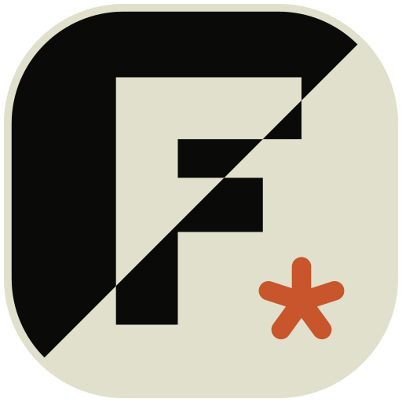
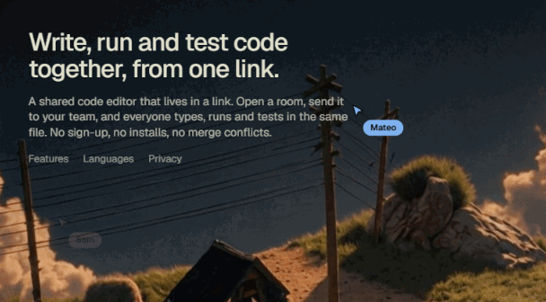
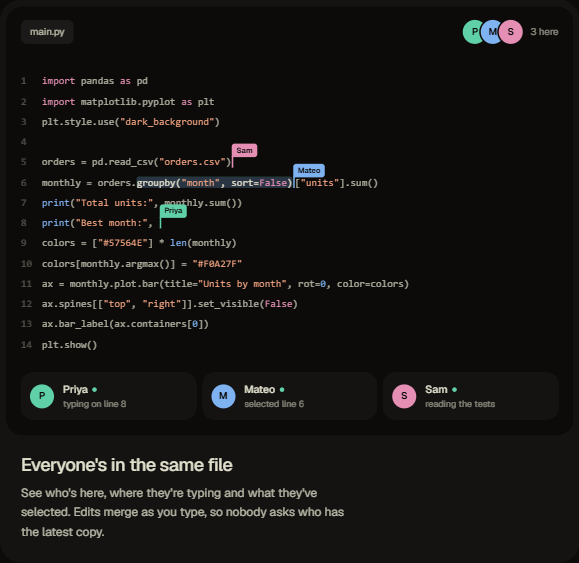
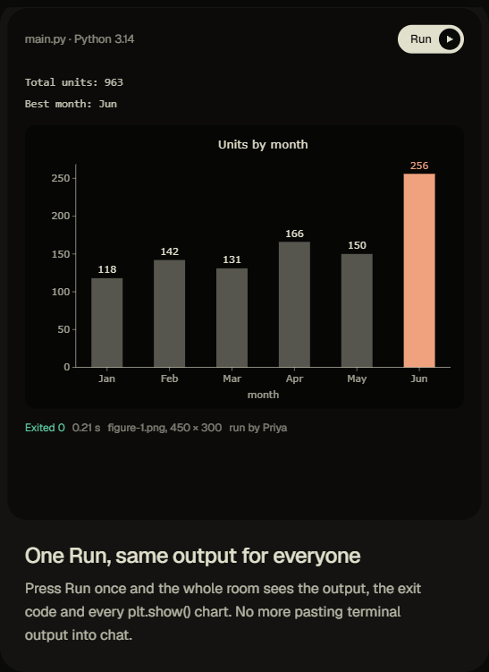
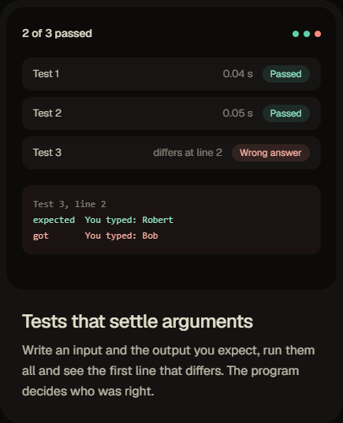
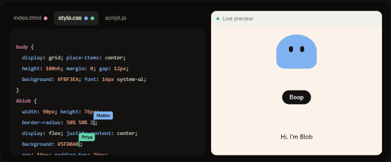
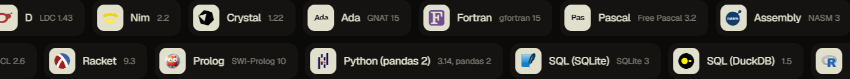
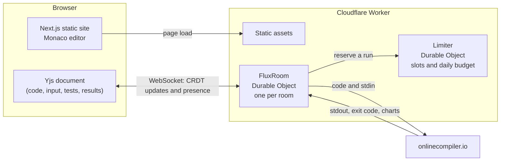
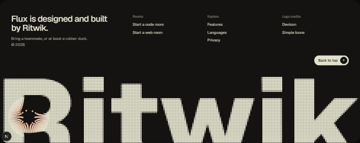

# Flux

**Write, run and test code together, from one link.** 
**Pair programming, minus the elbows.**

A collaborative code editor that lives in your browser. Open a room, send the link, 
and watch everyone type, run and test in the same file while you all agree the bug was already there. 
No sign-up, no installs, no merge conflicts, no "works on my machine". 
Bring a teammate. Or at least a rubber duck. 🦆

[**Open Flux →**](https://flux.rq3.workers.dev)

 

 

 

## Contents

- [Why Flux](#why-flux)
- [Features](#features)
- [48 languages](#48-languages)
- [How it works](#how-it-works)
- [Built with](#built-with)
- [Privacy and limits](#privacy-and-limits)
- [Credits](#credits)

## Why Flux

Pairing on code usually means one person types while the other squints at a shared screen, or everyone pastes snippets into chat and hopes they match. Flux gives the whole group **one live file**: every cursor visible, every edit merged as it happens, and a single Run button whose output everyone sees at once.

A room is just a link. There are no accounts to create and nothing to install, and a room cleans itself up a couple of minutes after the last person leaves.

## Features

### Everyone's in the same file

See who's in the room, where they're typing and what they've selected. Edits are merged with a CRDT as you type, so there's never a "who has the latest copy?" moment, and nothing to pull.

### One Run, same output for everyone

Press Run once and the whole room sees the output, the exit code, the time taken and every `plt.show()` chart. Input (stdin) is shared too, so everyone runs the same program on the same data.

### Tests that settle arguments

Write an input and the output you expect, then run them all at once. Each case passes or fails, and a failure points at the first line that differs. The program decides who was right.

<table>
  <tr>
    <td width="56%"></td>
    <td width="44%"></td>
  </tr>
</table>

### HTML, CSS and JS, previewed as you type

Web rooms give everyone the same three files and a live preview that redraws as they type. Open it in a new tab or full screen when the layout needs room.

### And the small things

- **No accounts.** Pick a name and a colour; Flux remembers them in your browser.
- **Share links that ask first.** Someone opening your link is asked for their own name and colour, then dropped into the room.
- **Rooms survive reloads** and are deleted a couple of minutes after everyone leaves.
- **Shared input and tests** are part of the room, so a newcomer sees exactly what you see.
- **Works on a phone.** The editor, output and tests fit a 360 px screen.

## 48 languages

From Python to COBOL. Yes, COBOL. Pick one from the searchable menu and press Run; the toolchains run on the server, so your laptop stays clean.

| Group | Languages |
| --- | --- |
| **Popular** | Python 3.14 · JavaScript (Node.js 24) · TypeScript (Deno) · Java (OpenJDK 25) · C++ (G++ 15) · C++20 · C (GCC 15) · C# (.NET 10) · Go 1.26 · Rust 1.93 · Kotlin 2.4 · Swift 6.4 |
| **Systems** | Zig 0.17 · D (LDC 1.43) · Nim 2.2 · Crystal 1.22 · Ada (GNAT 15) · Fortran (gfortran 15) · Pascal (Free Pascal 3.2) · Assembly (NASM 3) · Objective-C (Clang 21) |
| **Scripting** | PHP 8.5 · Ruby 4.0 · Bash 5.2 · PowerShell 7.6 · Perl 5.44 · Lua 5.5 · Dart 3.13 · Groovy 6.0 |
| **Functional** | Haskell (GHC 9.12) · OCaml 5.4 · F# (.NET 10) · Elixir 1.20 · Erlang (OTP 29) · Clojure 1.12 · Scala 3.10 · Common Lisp (SBCL 2.6) · Racket 9.3 · Prolog (SWI-Prolog 10) |
| **Data** | Python with pandas 2 · SQL (SQLite 3) · SQL (DuckDB 1.5) · R 4.6 · Julia 1.13 · Octave 11 |
| **Other** | Visual Basic (.NET 10) · COBOL (GnuCOBOL 3.2) · FreeBASIC 1.10 |

## How it works

Flux is a single Cloudflare Worker. The site is a static Next.js export served from the edge; only room traffic reaches the Worker.

- **Real-time sync.** Each room is a Durable Object holding a Yjs document. Every keystroke is a CRDT update over a WebSocket, so concurrent edits merge without conflicts and late joiners get the full state at once.
- **Runs happen once, for everyone.** The room calls the compiler API, writes the result into the shared document, and every browser renders it. The API key never reaches the browser.
- **Fair use is built in.** A single Limiter object holds an account-wide cap on parallel runs and a daily run budget, and reports runs left through `/status`.
- **Rooms clean up after themselves.** When the last person leaves, the room sets an alarm and deletes its storage once it fires.
- **Abuse protection without friction.** Creating a new room is checked with invisible Cloudflare Turnstile; joining needs nothing.

## Built with

| Layer | Technology |
| --- | --- |
| Front end | [Next.js 15](https://nextjs.org) (static export), React 19, TypeScript, [Tailwind CSS](https://tailwindcss.com), [Framer Motion](https://www.framer.com/motion/), [Lenis](https://lenis.darkroom.engineering) |
| Editor | [Monaco](https://microsoft.github.io/monaco-editor/) with [y-monaco](https://github.com/yjs/y-monaco) bindings |
| Collaboration | [Yjs](https://yjs.dev) CRDTs over [PartyServer](https://github.com/cloudflare/partykit) / y-partyserver |
| Back end | [Cloudflare Workers](https://workers.cloudflare.com), SQLite-backed [Durable Objects](https://developers.cloudflare.com/durable-objects/), Static Assets |
| Code execution | [onlinecompiler.io](https://onlinecompiler.io) API |
| Bot protection | [Cloudflare Turnstile](https://www.cloudflare.com/products/turnstile/) |
| Testing | [Vitest](https://vitest.dev) |

The whole thing runs on Cloudflare's free tier.

## Privacy and limits

- No accounts and no tracking. Your name and colour stay in your browser.
- Anyone with a room's link can open it, so don't put secrets in a room.
- Code and input are sent to onlinecompiler.io when someone presses Run.
- Rooms are deleted a couple of minutes after the last person leaves.
- Runs share a daily budget, so heavy use may hit the limit until the next UTC day.

The full policy is at [flux.rq3.workers.dev/privacy](https://flux.rq3.workers.dev/privacy).

## Credits

- Language logos from [Devicon](https://devicon.dev) (MIT, licence in [`public/logos`](public/logos/LICENSE-devicon.txt)) and [Simple Icons](https://simpleicons.org) (CC0). Trademarks belong to their owners.
- Code execution by [onlinecompiler.io](https://onlinecompiler.io).
- Footer based on Halftone Wordmark Footer by Kedhareswer Naidu on [21st.dev](https://21st.dev/@kedhareswer/components/halftone-wordmark-footer) (MIT).

 

Designed and built by **Ritwik**.

